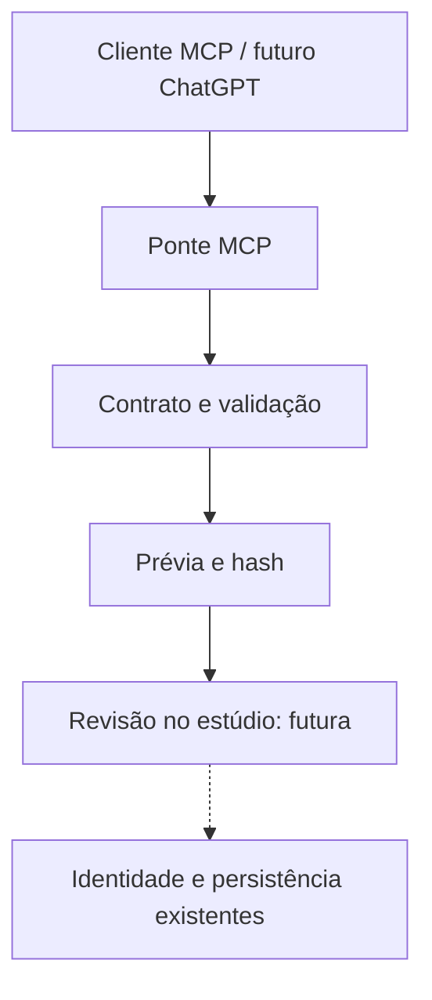

# ADR 0001 — Ponte MCP em vez de outra plataforma de criação

## Contexto

O OpenCreator é um workspace local extenso, com Codex App Server, desktop,
credenciais, plugins, serviços de mídia e runtime Go/FFmpeg. Já existem estúdios
no ecossistema Radar. O pedido explícito foi adaptar a experiência para ChatGPT
em um novo repositório. Copiar o monorepo inteiro duplicaria responsabilidades.

## Decisão

Criar uma implementação independente da fronteira de conversa e briefing, sem
copiar código ou assets do OpenCreator. Preservar TypeScript e usar o SDK oficial
MCP. O cliente de conversa faz interpretação; regras e contratos ficam no servidor.
Nenhuma chave OpenAI é necessária porque o servidor não chama a OpenAI API.

As três primeiras ligações estão implementadas e testadas localmente. A revisão
e persistência são responsabilidade futura do estúdio, não parte deste servidor.

## Alternativas e consequências

| Alternativa | Decisão |
| --- | --- |
| Fork integral e troca de marca | Rejeitar nesta fatia; mantém runtime complexo e direitos de assets não validados |
| Módulo no estúdio existente | Menor duplicação, mas o pedido exige repo novo; a ponte permanece pequena |
| Reescrever engine em Python | Rejeitar; não resolve o problema de interface |
| Novo agente, fila e banco | Rejeitar; não há execução assíncrona nem estado a persistir aqui |
| Ponte MCP de contratos | Adotar como piloto; transporte testável e sem autoridade para gerar/publicar |

Trade-off: entrega conversa → prévia de briefing, e não todas as funcionalidades
do OpenCreator. Geração real e conexão ChatGPT exigem novas fatias, direitos,
identidade, orçamento e homologação. Reversão: desligar o processo e remover a
configuração do cliente; nenhum banco operacional foi modificado.
